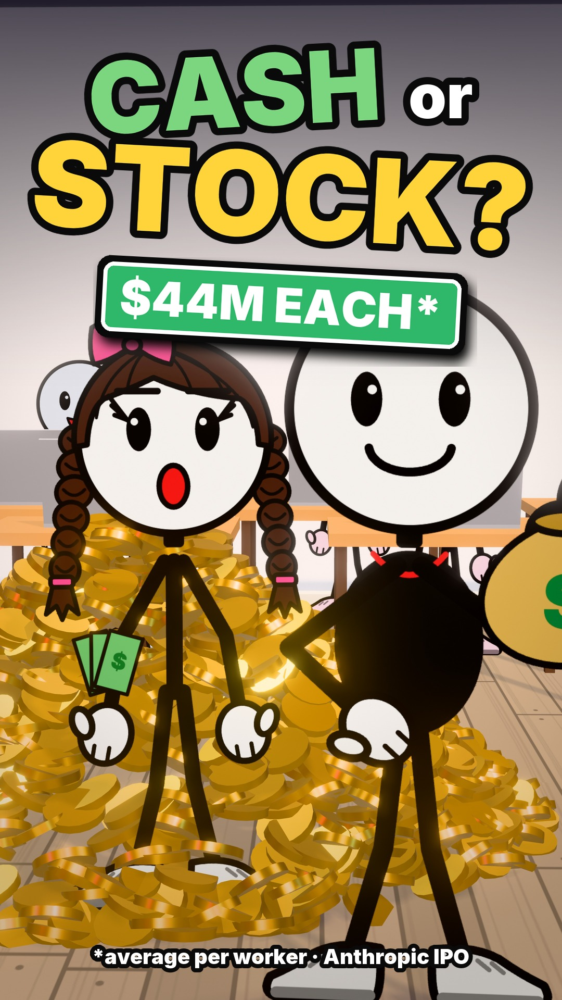

# golumgenrepo: stick figures in 3D sets, made fully in code

A small engine for vertical (9:16) explainer videos: flat 2D stick-figure characters acting inside lit 3D sets,
with cinematic camera moves (crane, dolly, low angle, close-ups, whip and flash cuts), big on-screen labels,
word-by-word captions and 4K output. Everything is drawn in code (three.js in headless Chrome). No AI image or
video services, no API keys.



`example-anthropic-ipo/` is a complete video project (a ~47 s money explainer) you can copy as a template.

## What you need

- Node.js 22+ and Google Chrome (the renderer drives Chrome headless, no npm packages)
- ffmpeg
- Python 3 with numpy, scipy and Pillow (music, sound mix, thumbnail)

## Quick start

```bash
cd example-anthropic-ipo
node tools/capture.mjs check                       # boots the project, lists shots + captions
node tools/capture.mjs preview                     # serves it; open the printed URL to watch in a browser
node tools/capture.mjs sheet review/sheet.jpg 1.5  # contact sheet, one frame every 1.5 s
node tools/capture.mjs video renders/test.mp4      # full video, 1080x1920
QS='&res=2' node tools/capture.mjs video renders/test-4k.mp4   # 4K (2160x3840)
```

The voice track is not included, so a render is silent until you add your own narration (see below).

## How a video is built

| File | What it does |
|---|---|
| `script.json` | the narration lines, voice settings and sources |
| `data/lines.json`, `data/words.json` | when each line and each word is spoken (everything on screen is timed to these) |
| `src/shots.js` | **the video itself**: the 3D sets and the list of shots (camera, acting, labels, sound cues) |
| `src/kit.js` | the toolbox: props (rooms, desks, houses, signs, coins...), the cast, acting, labels, and the camera "director" |
| `src/stick2d.js`, `src/stick3d.js` | the stick-figure character (poses, faces, hair, hand props) drawn onto a flat card that turns to face the camera |
| `src/main.js` | captions (2-4 words, spoken word in yellow), logo, end card |
| `src/core/` | three.js engine: lighting, bloom, depth of field, colour grade |
| `tools/capture.mjs` | frame-exact rendering through headless Chrome |
| `tools/mix_cc.py` | mixes narration + music + sound effects (whoosh, pop, slam, sparkle...) into `data/mix.wav` |
| `tools/thumb.py` | vertical thumbnail from a clean frame (`QS='&nocap'` renders frames without captions or labels) |
| `tools/render_safe.py` | optional: renders 4K in 8 s pieces and re-renders any piece whose 3D dropped out |
| `../audio-tools/make_music.py` | background music made with numpy: `python3 make_music.py bounce 48 audio/music.wav` |
| `../audio-tools/make_srt.py` | captions file: `python3 make_srt.py example-anthropic-ipo` -> `data/captions-en.srt` |

### Making a new video

1. Copy `example-anthropic-ipo/` to a new folder and edit `script.json`.
2. Record or generate the narration as `data/narration.wav` (any TTS works; we used the local open-source Kokoro voice)
   and write the timings:
   - `data/lines.json`: `{ "duration": 47.2, "lines": [ { "i": 0, "text": "...", "start": 0.35, "end": 5.64 }, ... ] }`
   - `data/words.json`: `[ { "w": "Anthropic,", "line": 0, "s": 0.35, "e": 1.1 }, ... ]` (word timings, e.g. from Whisper)
3. Write the sets and shots in `src/shots.js`. A shot looks like this:
   ```js
   add({ id: 'office-crane', at: L(4), scene: OS, people: [leo, mia], tr: 'whip',
     cam: { from: [0, 6, 6], to: [0, 2.7, 4.2], look: [0, 0.5, -2.8], fov: 44, fov2: 39 },
     update: (t) => { act(leo, t, [{ t: 0, pose: 'thumbsUp', expr: 'grin', extra: ['bag'] }]); },
     over: (lt, d, t) => { stamp('$44 MILLION', 540, 340, 116, GRN, -0.05, (t - Wd('forty', 4)) / 0.4); } });
   ```
   `L(i)` is when line i starts and `Wd(word, i)` is when a word in line i is spoken, so cuts and labels land on the voice.
4. `node tools/capture.mjs cues`, then `python3 tools/mix_cc.py .` (needs `audio/music.wav` and `data/narration.wav`),
   then render.

Characters: `LEO` (hoodie) and `MIA` (braids, pink bow). Poses: standing, thumbsUp, pointing, thinking, jumping, running,
shrug, wave. Faces: happy, sad, angry, surprised, wink, thinking, worried, smirk, bored, smug, cry, grin.
Hand props: bag, ticket, clip, cash, bar, phone, book, cup, letter, box, glasses, cap, tie, lanyard, headset, shades.

### Tips

- The vertical frame is narrow (about 2 m of width at 5-6 m from the camera), so keep people and props close together
  and check a contact sheet before the full render.
- Render only one 4K video at a time on a computer. Two at once can make the 3D layer drop out (black or white frames).
- Faces stay flat white with clean outlines: `cel: false` on the cast and no bloom on the figures (`bloomThreshold: 1.0`).

## Credits and licences

- three.js and its add-ons (in `vendor/`): MIT licence, see `vendor/LICENSE-three.txt`.
- Inter font (in `fonts/`): SIL Open Font License 1.1, see `fonts/LICENSE-Inter.txt`.
- `src/brand/coin.png` is the Coin Lessons channel logo, shown in the corner and on the end card.
  Replace it with your own logo for your videos.
